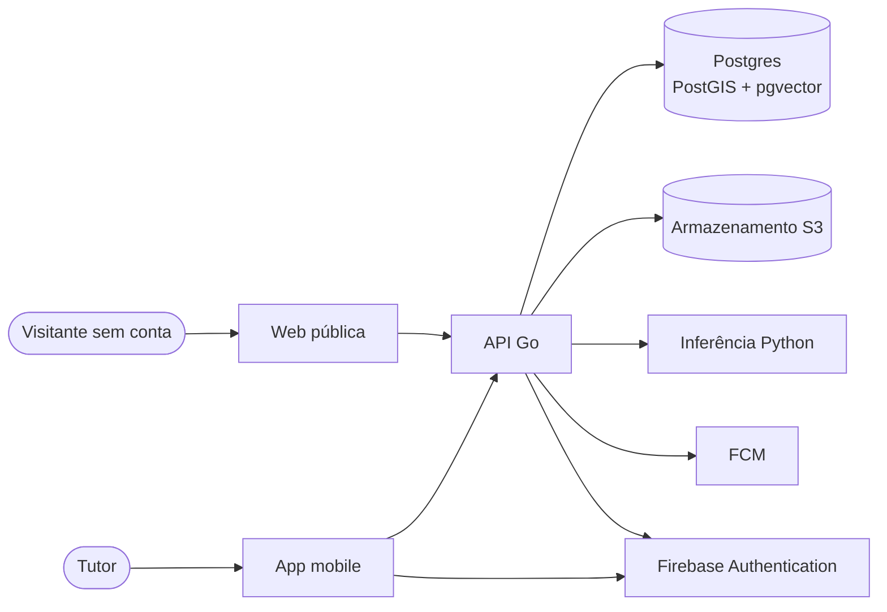
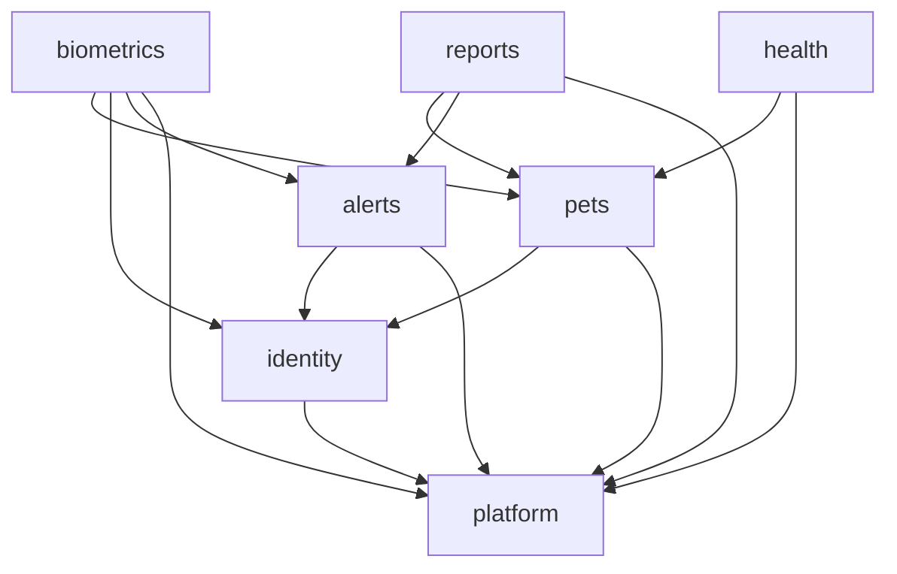

# Arquitetura

Este documento descreve as partes do sistema e as regras entre elas. Cada escolha aponta para o ADR que a justifica. Os requisitos estão em [requisitos.md](requisitos.md).

## Contexto



| Parte | Responsabilidade | ADR |
|---|---|---|
| App mobile | Tudo que o tutor faz: conta, pets, saúde, focinho, ocorrências, alertas. | [0006](adr/0006-mobile-expo-web-publica.md), [0016](adr/0016-navegacao-e-foto-no-app.md), [0017](adr/0017-arquivo-do-aparelho-no-app.md) |
| Web pública | O que o visitante faz sem instalar nada: mural, ficha, "encontrei um pet", avistamento, carteirinha por link. | [0006](adr/0006-mobile-expo-web-publica.md) |
| API Go | Um binário. Regras de negócio, acesso ao banco, tarefas em segundo plano. | [0002](adr/0002-backend-go-monolito-modular.md) |
| Postgres | Único estado: dados, busca geográfica, busca por vetor, fila de tarefas. | [0003](adr/0003-estado-postgres-fila-no-banco.md) |
| Armazenamento S3 | Fotos e anexos. SeaweedFS no ambiente local. | [0003](adr/0003-estado-postgres-fila-no-banco.md), [0012](adr/0012-servidor-s3-local.md), [0015](adr/0015-cliente-de-armazenamento.md) |
| Inferência Python | Foto do focinho para vetor. Sem estado. | [0007](adr/0007-inferencia-python-onnx.md), [0018](adr/0018-python-e-dependencias-da-inferencia.md) |
| Firebase Authentication | Identidade do tutor: senha, sessão, login com Google, redefinição de senha. No ambiente local e no CI, o emulador. | [0008](adr/0008-autenticacao-firebase.md), [0013](adr/0013-firebase-no-app.md), [0014](adr/0014-emulador-do-firebase-auth.md) |

## Estrutura do repositório

Um repositório com três projetos e a documentação.

```
backend/
  cmd/api/              main: lê a configuração, liga os módulos, sobe HTTP e os workers
  internal/
    identity/           tutor, validação do ID token, termos, exclusão de conta
    pets/               pets e foto de perfil
    biometrics/         cadastro do focinho, identificação, confirmação, recálculo
    reports/            perdido, achado, avistamento, mural
    alerts/             localização, dispositivos, notificações, push
    health/             eventos de saúde, anexos, carteirinha compartilhada
    api/                código gerado do contrato (tipos e interface do servidor), não editado à mão
    platform/           postgres, storage, jobs, httpx (middleware), config, firebase, inference, imagefile
  db/migrations/        SQL das migrations
  db/queries/           SQL das consultas (entrada do sqlc)
api/openapi.yaml        contrato da API
mobile/                 projeto Expo (app e web pública, ver a nota abaixo)
inference/              serviço Python
deploy/                 compose e arquivos de publicação
docs/                   este diretório
```

Nota: a web pública é o alvo web do mesmo projeto Expo ([ADR 0022](adr/0022-web-publica-no-alvo-web-do-expo.md)). Uma página pública é uma rota fora da proteção de sessão, e tem um orçamento de 500 KB de JavaScript com gzip.

O módulo Go fica em `backend/` e não na raiz. Motivo: `go build ./...` na raiz entra em `mobile/node_modules`.

## Módulos do backend

Regras, iguais para todos os módulos:

1. Um módulo é um pacote Go. Ele tem os tipos do domínio, o serviço, as consultas e os handlers HTTP daquele domínio.
2. Um módulo escreve só nas próprias tabelas.
3. Um módulo chama outro módulo por uma interface declarada em quem consome. Exemplo: `reports` declara a interface `PetOwnerChecker`, e `pets` a satisfaz.
4. Leitura com `JOIN` entre tabelas de módulos diferentes é permitida e fica listada abaixo. É o custo aceito de um banco único.
5. `platform` não conhece nenhum módulo de domínio.

Dependências permitidas:



A dependência de `biometrics` para `alerts` é a notificação de RN-16. Ela passa a existir na fatia 6, com o módulo `alerts`.

Leituras com `JOIN` entre módulos, conhecidas pelos requisitos:

| Consulta | Módulo dono | Lê também | Requisito |
|---|---|---|---|
| Busca dos focinhos mais parecidos | `biometrics` | `pets` (pet não excluído). A leitura de `identity` (conta ativa) entra na fatia 9 | RN-10, RN-11 |
| Trava do pet durante o cadastro do focinho | `biometrics` | `pets` (linha do pet, com `FOR UPDATE`, sem escrita) | RN-09 |
| Nome e foto de perfil dos candidatos | `biometrics` | `pets` | RN-62 |
| Avisos de encontro do tutor | `biometrics` | `pets` (pets do tutor, não excluídos) | RN-66 |
| Tutores perto de um ponto | `alerts` | `identity` (conta ativa) | RN-32, RN-33 |
| Mural com a foto do pet | `reports` | `pets` | RF-16 |

## Tarefas em segundo plano

Uma tabela `jobs` no Postgres. Workers no mesmo binário leem com `SELECT ... FOR UPDATE SKIP LOCKED` ([ADR 0003](adr/0003-estado-postgres-fila-no-banco.md)).

| Tarefa | Quem cria | Requisito |
|---|---|---|
| `notify_lost_report` | `reports`, na mesma transação da ocorrência | RF-24, RNF-01 |
| `send_push` | `alerts` | RF-26 |
| `reembed_noseprint` | `biometrics`, quando a versão do modelo muda. Até a fila de tarefas existir (fatia 6), o recálculo é executado na subida da API, em uma goroutine (RN-67) | RF-15 |
| `purge_expired_data` | agenda diária | RF-32, RN-42 |
| `delete_identity_user` | `identity`, na mesma transação da anonimização | RF-08, RN-03 |

Concorrência, declarada por regra:

- O contexto raiz nasce em `main` e é cancelado por `SIGTERM`.
- Cada worker para quando o contexto é cancelado e termina a tarefa em curso antes de sair.
- Uma tarefa que falha volta para a fila com espera crescente. Depois do limite de tentativas ela fica marcada como falha.
- Toda tarefa precisa ser segura para executar duas vezes.
- O recálculo dos vetores (RN-67) é uma goroutine que nasce em `main` depois de o servidor HTTP subir. Ela termina quando o recálculo termina ou quando o contexto é cancelado, e `main` espera por ela antes de sair. Se o serviço de inferência não responde, ela escreve um aviso no log e para: os cadastros que faltam ficam para a subida seguinte.

## Dados

- PostgreSQL com PostGIS (distância) e pgvector (vetores com índice HNSW e cosseno).
- Um vetor vai para o banco como texto, e a consulta converte para o tipo `vector` ([ADR 0021](adr/0021-vetor-como-texto-nas-consultas.md)).
- A busca de focinhos muda dois parâmetros do índice HNSW na transação dela: `hnsw.ef_search = 100`, porque o padrão de 40 é menor que os 50 cadastros de RN-10, e `hnsw.iterative_scan = strict_order`, para o índice ler mais cadastros quando os filtros de RN-11 tiram alguns. Um teste de integração força o uso do índice e confere os 50.
- O esquema nasce das migrations de `backend/db/migrations/`. As migrations são a fonte do modelo de dados.
- A API aplica as migrations pendentes quando sobe, antes de aceitar requisições. A primeira migration cria as extensões PostGIS e pgvector.
- `GET /v1/health` responde 503 com o código `unavailable` quando o banco não responde.
- Nomes de tabelas e colunas em inglês ([ADR 0009](adr/0009-idioma.md)).
- Chaves primárias UUID.

## API

- `api/openapi.yaml` é a fonte do contrato. Os tipos do Go e do TypeScript são gerados dele ([ADR 0005](adr/0005-contrato-openapi.md)).
- O contrato usa a OpenAPI 3.1.
- O código Go é gerado em `backend/internal/api/` pelo `oapi-codegen`, no modo `strict-server`: cada handler recebe um tipo de requisição e devolve um dos tipos de resposta que o contrato declara. O comando é `go generate ./...`, no diretório `backend`.
- Os tipos TypeScript são gerados em `mobile/src/api/schema.d.ts` pelo `openapi-typescript`. O comando é `npm run generate:api`, no diretório `mobile`. O gerador é executado com `npx`, fora das dependências do app.
- O código gerado é versionado. O CI falha se ele estiver diferente do contrato.
- O teste `TestContractIsValid` confere que o contrato é um documento OpenAPI válido.
- Erros em um formato único: `{"error": "<código>", "message": "<texto>"}`. O código é estável e o app decide a mensagem pela tabela de códigos.
- Os códigos de erro estão no contrato, no schema `ErrorCode`. Um código novo entra no contrato antes de entrar no servidor.
- Uma rota que não existe e um método que a rota não aceita recebem 404 com o código `not_found`. O 405 não é usado.
- Uma rota com `GET` atende também `HEAD`, com a mesma resposta sem o corpo. É o comportamento do `http.ServeMux`.
- Um erro devolvido por uma operação, ou um panic em um handler, recebe 500 com o código `internal_error`. O detalhe do erro vai só para o log, com o identificador da requisição.
- Rotas em inglês, com versão no caminho: `/v1/...`.
- Endpoints públicos têm limite de tentativas por IP (RN-43). O IP é o endereço da conexão, e a rota é o padrão do contrato, não o caminho com os identificadores. Acima do limite, a resposta é 429 com o código `rate_limited`. Atrás de um proxy, o endereço da conexão é o do proxy: a fatia 10 decide de onde a API lê o endereço do cliente.
- Uma rota pública responde com `Access-Control-Allow-Origin: *`, para a página pública ler a resposta de outra origem. As rotas com token não têm esse cabeçalho.
- Autenticação: uma operação do contrato sem `security` é pública. Toda outra operação pede o ID token do Firebase no cabeçalho `Authorization: Bearer`. Sem token válido, a resposta é 401 com o código `unauthenticated` (RN-46). A conferência do token acontece antes da leitura do corpo.
- O módulo `identity` depende da interface `TokenVerifier`. A implementação com o Firebase Admin SDK fica em `platform/firebase`, e `cmd/api` liga as duas.
- Um corpo ou um parâmetro que não pode ser lido recebe 400 com o código `invalid_request`. Um dado que quebra uma regra de negócio recebe a mesma resposta, com a regra na mensagem.
- Um recurso de outro tutor não existe para quem chama: a resposta é 404, igual à de um recurso que nunca existiu (RN-52).
- Uma conta sem tutor registrado recebe 404 com o código `owner_not_found` nas operações que precisam do tutor.
- O corpo de uma requisição JSON tem no máximo 1 MiB, o de um envio de foto de perfil tem no máximo 6 MiB, e o de um envio de foto de focinho tem no máximo 9 MiB. Um corpo maior recebe a mesma resposta 400.
- Uma foto de focinho recusada recebe 422, com o motivo no código: `species_not_supported`, `image_low_quality` ou `image_framing`.
- Quando o serviço de inferência não responde, a operação que precisa dele recebe 503 com o código `unavailable`. A causa vai para o log. A API sobe sem o serviço de inferência.
- Um arquivo enviado tem o tipo conferido pelos bytes do arquivo, não pelo que o cliente declara (RN-54).
- A URL temporária de uma foto é assinada com o endereço público do armazenamento (`S3_PUBLIC_ENDPOINT`).
- O emulador do Authentication só é aceito com um projeto de demonstração (`FIREBASE_PROJECT_ID` com o prefixo `demo-`). Com outro projeto, a API não sobe.
- O servidor HTTP dá 2 minutos para o cliente enviar uma requisição e 3 minutos para a resposta terminar. Uma foto de 8 MB em uma rede móvel lenta leva cerca de 45 segundos.
- No app e na página pública, a foto de focinho escolhida da galeria vai para a API sem nova compressão. A foto tirada pela câmera é comprimida uma vez, com qualidade 0,9.
- A confirmação grava a foto no armazenamento antes da transação. A transação que trava a identificação não chama o armazenamento. Se a foto não for usada, ela é apagada.
- Toda resposta tem o cabeçalho `X-Request-Id`, com o identificador que aparece nas linhas de log da requisição (RNF-07).

## Serviço de inferência

Só a API chama o serviço de inferência. Ele não tem autenticação. Na publicação, ele não fica exposto fora da rede interna. No ambiente local, a porta 8000 fica aberta só para a própria máquina.

| Caminho | Entrada | Resposta |
|---|---|---|
| `POST /v1/nose/embedding` | O conteúdo da imagem no corpo | 200 com `embedding` (512 números), `modelVersion` e `quality` |
| `GET /v1/model-info` | Nada | 200 com `modelVersion` e `dimensions` |
| `GET /health` | Nada | 200 com `status` |

Erros de `POST /v1/nose/embedding`, no mesmo formato da API (`error` e `message`):

| Estado | `error` | Quando | Regra |
|---|---|---|---|
| 413 | `image_too_large` | O corpo passa de 8 MB | RN-17 |
| 400 | `image_invalid` | O conteúdo não é uma imagem que o serviço consegue ler, ou a imagem tem pixels demais | RN-17, RN-57 |
| 422 | `image_low_quality` | A nitidez está abaixo do mínimo | RN-20 |
| 422 | `image_framing` | O detector não achou um focinho | RN-21 |

A ordem das conferências é a ordem da tabela. Os outros erros usam o mesmo formato: 404 `not_found` para um caminho que não existe, 405 `method_not_allowed` para um método errado e 500 `internal_error` para uma falha do serviço.

O serviço só responde depois de carregar os pesos e conferir o SHA-256 deles (RN-22). Antes disso, a porta não aceita conexão.

Limites conhecidos:

- Uma thread executa as inferências, uma por vez (RN-23). As requisições em espera ficam na memória, cada uma com até 8 MB. O serviço não limita essa fila: quem limita as chamadas é a API (RN-43).
- Uma imagem de 50 milhões de pixels (RN-57) ocupa cerca de 150 MB na memória enquanto é lida, e as cópias da rotação e da conversão de cor somam a isso. Só uma imagem é lida por vez.

Os arquivos de pesos ficam em uma release do repositório, com a tag `model-<versão do modelo>`. O script `inference/download_weights.sh` baixa os arquivos e confere o SHA-256.

## Convenções

### Código

- Go: Effective Go, Go Code Review Comments e o guia de estilo da Uber. `gofmt` e `go vet` em toda mudança.
- Lint: um comando por projeto, usado no ambiente local e no CI. No backend é `./lint.sh` (`gofmt` e `go vet`). No app é `npm run lint` (conferência de tipos do TypeScript). Na inferência é `./lint.sh` (`ruff`).
- Erros em Go: sempre com contexto e `%w`. Nenhum erro descartado.
- Log: `log/slog` com saída JSON e um identificador por requisição.
- Configuração: variáveis de ambiente, lidas uma vez em `main` e validadas na subida. O processo não sobe com configuração inválida.
- Segredos: nenhuma senha, chave secreta ou token fica no repositório, em issue ou em PR. Onde há segredo, um arquivo `.env.example` versionado tem os nomes das variáveis, sem os valores secretos. Os valores ficam em um arquivo `.env`, que o `.gitignore` exclui. No CI, eles ficam nos secrets do GitHub Actions ou são gerados em cada execução.
- TypeScript: modo `strict`.
- Python: PEP 8, com `ruff` para o lint e para o formato. Anotações de tipo nas funções.

### Git

- Toda tarefa em trabalho é uma issue no GitHub, criada antes de o trabalho começar. Cada fatia do roteiro é um milestone, e a issue de uma tarefa fica no milestone da fatia dela. O andamento do projeto é lido nas issues e nos milestones.
- `develop` é o branch de integração e o branch padrão do repositório no GitHub. Cada issue tem um branch próprio, criado a partir de `develop` quando o trabalho da issue começa.
- Nome do branch de uma issue: `<tipo>/<número da issue>-<resumo em inglês>`. O tipo é o mesmo do Conventional Commits. Exemplo: `feat/8-backend-health`.
- Um PR por issue, com destino `develop`. O merge é por squash: uma issue vira um commit em `develop`, com o título do PR. A issue é fechada quando o PR dela entra em `develop`. O branch da issue é apagado logo depois do merge, no GitHub e no ambiente local.
- Nenhuma mudança entra direto em `main`. `main` recebe mudanças só por PR a partir de `develop`, no fim de cada fatia do roteiro. A regra vale por convenção: a proteção de branch do GitHub não está ligada. Esse PR entra com commit de merge, para `main` e `develop` terem o mesmo histórico.
- Commits no formato Conventional Commits, só com título, em inglês ([ADR 0009](adr/0009-idioma.md)).
- O CI precisa passar antes do merge.

### Documentação

- Um ADR por decisão, no formato de [ADR 0001](adr/0001-registrar-decisoes-em-adrs.md). Um ADR aceito não é editado: uma decisão nova cria um ADR novo que substitui o anterior.
- Uma decisão ou uma implementação que muda o que um documento diz atualiza esse documento no mesmo PR. Isso vale para este documento, para os requisitos, para o roteiro e para os READMEs.
- Um requisito em rascunho é fechado em [requisitos.md](requisitos.md) antes do código da fatia dele.
- Cada projeto (`backend`, `mobile`, `inference`) tem um README com três partes: como executar, como testar, variáveis de ambiente.

## Testes

| Nível | O que cobre | Como |
|---|---|---|
| Unidade (Go) | Regras de domínio: limiares, agrupamento por pet, estados da ocorrência | Testes de tabela, sem banco |
| Integração (Go) | Consultas SQL, PostGIS, pgvector, fila de tarefas | Postgres do compose, testes com a build tag `integration` |
| Contrato | A API responde o que o OpenAPI declara | Validação das respostas contra o `api/openapi.yaml` nos testes de integração |
| Inferência | O vetor do serviço é igual ao vetor de referência da calibração, com as mesmas decisões de nitidez e de enquadramento | Valores de referência versionados junto do teste, com imagens geradas e com fotos reais ([ADR 0007](adr/0007-inferencia-python-onnx.md), [ADR 0019](adr/0019-dados-do-teste-de-igualdade.md)) |
| Mobile | Lógica pura e chamadas da API | Testes de unidade com Jest |

As ferramentas de cada nível estão no [ADR 0010](adr/0010-ferramentas-de-teste.md). As do serviço de inferência estão no [ADR 0018](adr/0018-python-e-dependencias-da-inferencia.md).

Regra: toda regra de negócio de [requisitos.md](requisitos.md) tem um teste que cita o identificador dela e usa o mesmo valor (exemplo: RN-13, similaridade mínima 0,351).

## CI

Os workflows ficam em `.github/workflows/`. Cada um é disparado só pelos arquivos que ele confere.

| Workflow | Disparado por | O que confere |
|---|---|---|
| `backend` | `backend/`, `api/` | Lint, código gerado igual ao contrato, testes de unidade com detector de corrida, build, e que as bibliotecas de teste não entram no binário |
| `mobile` | `mobile/`, `api/` | Instalação, tipos gerados iguais ao contrato, lint e testes de unidade |
| `inference` | `inference/` | Lint, download dos pesos com conferência do SHA-256, e os testes no Linux x86, com o teste de igualdade das imagens geradas |
| `integration` | `backend/`, `api/`, `deploy/`, `inference/` | Baixa os pesos, sobe o compose (API, banco, servidor S3, emulador do Authentication e serviço de inferência), chama `GET /v1/health` da API, pede um vetor ao serviço de inferência e executa os testes de integração |

O workflow `integration` cria o `deploy/.env` com credenciais aleatórias em cada execução. Nenhum workflow tem credencial escrita.

## Glossário

O código usa o termo em inglês. A documentação e as telas usam o termo em português.

| Português | Inglês (código) | Significado |
|---|---|---|
| tutor | owner | Pessoa com conta, responsável por pets |
| conta | account | O usuário no provedor de identidade: e-mail e senha |
| identidade | identity | A conta que fez uma requisição, lida do ID token |
| termos de uso | terms | Texto que o tutor aceita no registro, com uma versão |
| visitante | visitor | Pessoa sem conta |
| pet | pet | Animal cadastrado |
| espécie | species | Cachorro, gato ou outro |
| raça | breed | Texto livre |
| sexo | sex | Macho, fêmea ou não informado |
| porte | size | Pequeno, médio ou grande |
| castrado | neutered | Sim ou não |
| data de nascimento | birth date | Data sem hora |
| peso | weight | Peso do pet em quilos |
| veterinário | vet | Nome, clínica e telefone de quem atende o pet |
| foto de perfil | profile photo | A foto que identifica o pet nas listas |
| focinho | nose | Região usada na biometria |
| vetor | embedding | Lista de 512 números que representa um focinho |
| nitidez | quality | Medida de foco da foto, de 0 a 1 |
| enquadramento | framing | A foto tem um focinho que o detector acha |
| pesos | weights | Arquivos do modelo treinado |
| versão do modelo | model version | Rótulo gravado com cada vetor |
| cadastro biométrico | noseprint | Foto do focinho com o vetor |
| identificação | identification | Busca de um focinho no acervo |
| candidato | candidate | Pet devolvido por uma identificação |
| correspondência forte | strong match | Candidato com similaridade no limiar do tamanho do acervo, ou acima dele |
| confirmação | confirmation | Quem encontrou o cão escolhe um candidato e deixa o contato |
| aviso de encontro | found notice | O que o tutor vê de uma confirmação: o pet e o contato de quem encontrou |
| cadastro principal | primary noseprint | O cadastro biométrico mais novo do pet |
| acervo | gallery | Conjunto de noseprints ativos de uma versão do modelo |
| ocorrência | report | Registro de perdido, achado ou avistado |
| perdido, achado, avistado | lost, found, sighting | Tipos de ocorrência |
| mural | board | Lista pública de ocorrências abertas |
| ficha | report detail | Página de uma ocorrência, com os avistamentos |
| resolver | resolve | O autor fecha a ocorrência: o pet voltou para casa |
| código do achado | resolve code | Código que quem publicou um achado sem conta usa para resolver o achado |
| aviso, notificação | notification | Mensagem para um tutor |
| evento de saúde | health event | Vacina, consulta, medicação, exame ou anotação |
| carteirinha | health card | Resumo de saúde do pet |
| compartilhamento | share link | Link público da carteirinha |

## Fora da v1

Cada item entra quando o gatilho acontece.

| Item | Gatilho para entrar |
|---|---|
| Broker de eventos (Kafka, NATS) | Um segundo serviço precisa reagir aos mesmos eventos |
| Redis | Mais de uma instância da API (limite de tentativas compartilhado) |
| Métricas e tracing (OpenTelemetry) | A primeira publicação com usuários reais |
| Detector de focinho no aparelho | Depois da prova técnica descrita no [roteiro](roteiro.md) |
| Login com Apple | Publicação na App Store |
| Endpoints de administração | Uma tarefa de administração que se repete |
