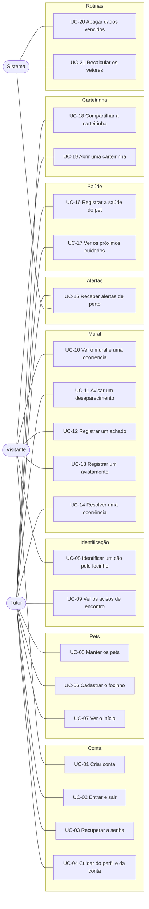

# Casos de uso

Os casos de uso do Nupii, escritos a partir do sistema pronto ([roteiro](roteiro.md), fatia 11). Cada caso aponta para os requisitos funcionais que ele cobre ([requisitos](requisitos.md)). As regras de negócio (RN) ficam nos requisitos e não são repetidas aqui.

## Atores

| Ator | Quem é |
|---|---|
| Tutor | Pessoa com conta, dona de um ou mais pets. |
| Visitante | Qualquer pessoa, com ou sem conta: quem encontrou um cão, quem vê o mural, quem abre uma carteirinha. |
| Sistema | Tarefas da API que rodam sem uma pessoa: a fila de jobs, a limpeza diária e o recálculo dos vetores. |
| Firebase | Contas (Authentication) e envio de push (Cloud Messaging). |

## Visão geral

## Conta

### UC-01 Criar conta

- **Ator:** Visitante. **RF:** RF-01, RF-03, RF-33.
- **Fluxo:** na primeira abertura do app, a apresentação mostra os caminhos (RF-33). O visitante informa o nome, o e-mail e a senha e aceita os termos. O Firebase cria a conta, e a API cria o tutor (`POST /v1/me`). Com o Google, a conta vem do Google, e o primeiro acesso pede o nome e o aceite dos termos.
- **Exceções:** e-mail já usado; senha curta; termos não aceitos. Um e-mail com senha que entra pelo Google confirma a senha, e o Google fica ligado à mesma conta (RN-02).
- **Estado:** o Google funciona na web. No Android ele espera a [issue #153](https://github.com/mcoldibelli/nupii/issues/153). A etapa de alertas do cadastro web espera a [issue #169](https://github.com/mcoldibelli/nupii/issues/169).

### UC-02 Entrar e sair

- **Ator:** Tutor. **RF:** RF-02, RF-03, RF-04.
- **Fluxo:** o tutor entra com e-mail e senha, ou com o Google na web. A sessão continua depois de fechar o app. O tutor sai pelo perfil.
- **Exceções:** e-mail ou senha incorretos; muitas tentativas; janela do Google bloqueada.

### UC-03 Recuperar a senha

- **Ator:** Tutor. **RF:** RF-05.
- **Fluxo:** o tutor informa o e-mail, e o Firebase envia o link. A resposta é a mesma para um e-mail sem conta.

### UC-04 Cuidar do perfil e da conta

- **Ator:** Tutor. **RF:** RF-06, RF-07, RF-08.
- **Fluxo:** o tutor muda o nome, troca a senha ou exclui a conta. A exclusão pede a senha de novo (ou o Google, numa conta sem senha) e apaga os pets, a saúde e os focinhos.

## Pets

### UC-05 Manter os pets

- **Ator:** Tutor. **RF:** RF-09, RF-10.
- **Fluxo:** o tutor cria, lista, vê, altera e exclui um pet, com a foto de perfil e os dados do veterinário.

### UC-06 Cadastrar o focinho

- **Ator:** Tutor. **RF:** RF-11.
- **Fluxo:** o tutor tira ou escolhe duas fotos do rosto do cão, de frente e de perto. No app, a câmera aparece ao vivo; na web, ele ajusta um quadrado em volta do rosto. O serviço de inferência acha o focinho, recorta o focinho e gera o vetor do recorte, e a API grava o focinho.
- **Exceções:** foto sem focinho, borrada, ou de longe (o focinho fica pequeno demais no recorte).

### UC-07 Ver o início

- **Ator:** Tutor. **RF:** RF-34, RF-29.
- **Fluxo:** o início mostra um pet por vez: a foto, os próximos cuidados, o peso ao longo do tempo e, na web, o mês e as ocorrências perto. Com um desaparecimento aberto, o início mostra a faixa do pet sumido.

## Identificação

### UC-08 Identificar um cão pelo focinho

- **Ator:** Visitante. **RF:** RF-12, RF-13.
- **Fluxo:** o visitante envia a foto do focinho de um cão encontrado. A API devolve até três pets candidatos. O visitante confirma um candidato e deixa nome, telefone e mensagem para o tutor.
- **Exceções:** foto recusada; nenhum candidato.

### UC-09 Ver os avisos de encontro

- **Ator:** Tutor. **RF:** RF-14.
- **Fluxo:** o tutor vê os avisos de quem confirmou um pet dele, com o contato e a mensagem.

## Mural

### UC-10 Ver o mural e uma ocorrência

- **Ator:** Visitante. **RF:** RF-16, RF-17.
- **Fluxo:** o visitante vê as ocorrências abertas de perdidos e achados, no mapa e na lista, e abre a ficha de uma delas, com os avistamentos.

### UC-11 Avisar um desaparecimento

- **Ator:** Tutor. **RF:** RF-18.
- **Fluxo:** pela folha "+" do início, com confirmação, ou pelo perfil do pet, o tutor marca o ponto e a hora. A ocorrência entra no mural e gera os alertas (UC-15).
- **Exceções:** o pet já tem um desaparecimento aberto.

### UC-12 Registrar um achado

- **Ator:** Visitante. **RF:** RF-19.
- **Fluxo:** o visitante registra um cão achado, com foto, ponto e descrição. Sem conta, ele recebe um código para resolver a ocorrência depois.

### UC-13 Registrar um avistamento

- **Ator:** Visitante. **RF:** RF-20.
- **Fluxo:** numa ocorrência de perdido, o visitante marca onde viu o cão.

### UC-14 Resolver uma ocorrência

- **Ator:** Tutor ou Visitante (autor). **RF:** RF-21.
- **Fluxo:** o autor marca a ocorrência como resolvida. Sem conta, o autor usa o código do achado.

## Alertas

### UC-15 Receber alertas de perto

- **Atores:** Tutor, Sistema, Firebase. **RF:** RF-22, RF-23, RF-24, RF-25, RF-26.
- **Fluxo:** o app envia a localização do tutor e registra o dispositivo. Quando um desaparecimento é registrado, um job cria uma notificação para cada tutor perto e envia o push. O tutor abre as notificações pelo sino e marca como lidas.
- **Estado:** o push no aparelho espera o build do app ([issue #154](https://github.com/mcoldibelli/nupii/issues/154)).

## Saúde

### UC-16 Registrar a saúde do pet

- **Ator:** Tutor. **RF:** RF-27, RF-28.
- **Fluxo:** pela folha "Anotar", o tutor escolhe o tipo (vacina, antipulgas, vermífugo, medicação, consulta, exame, sintoma, peso ou anotação) e preenche o formulário daquele tipo. Ele anexa fotos ou PDFs a um evento. "Já dei" registra a dose atrasada com a data de hoje.

### UC-17 Ver os próximos cuidados

- **Ator:** Tutor. **RF:** RF-29.
- **Fluxo:** o tutor vê as vacinas e as medicações com a próxima data e o lembrete ligado, com os atrasados primeiro.

## Carteirinha

### UC-18 Compartilhar a carteirinha

- **Ator:** Tutor. **RF:** RF-30.
- **Fluxo:** o tutor cria um link com validade e QR code, com ou sem os exames, e revoga um link. Na web ele também imprime a carteirinha ou salva em PDF.

### UC-19 Abrir uma carteirinha

- **Ator:** Visitante. **RF:** RF-31.
- **Fluxo:** quem tem o link vê a carteirinha. O link vencido ou revogado não abre.

## Rotinas

### UC-20 Apagar dados vencidos

- **Ator:** Sistema. **RF:** RF-32.
- **Fluxo:** todo dia às 3h de `America/Sao_Paulo`, um job apaga os dados pessoais com o prazo de retenção vencido e agenda a próxima limpeza.

### UC-21 Recalcular os vetores

- **Ator:** Sistema. **RF:** RF-15.
- **Fluxo:** na subida da API, os focinhos de outra versão do modelo recebem o vetor da versão atual. Um focinho que falha fica para a próxima subida.

## Cobertura

Todos os RF de [requisitos](requisitos.md) têm um caso de uso:

| RF | Caso de uso |
|---|---|
| RF-01, RF-33 | UC-01 |
| RF-02, RF-04 | UC-02 |
| RF-03 | UC-01, UC-02 |
| RF-05 | UC-03 |
| RF-06, RF-07, RF-08 | UC-04 |
| RF-09, RF-10 | UC-05 |
| RF-11 | UC-06 |
| RF-34 | UC-07 |
| RF-12, RF-13 | UC-08 |
| RF-14 | UC-09 |
| RF-15 | UC-21 |
| RF-16, RF-17 | UC-10 |
| RF-18 | UC-11 |
| RF-19 | UC-12 |
| RF-20 | UC-13 |
| RF-21 | UC-14 |
| RF-22 a RF-26 | UC-15 |
| RF-27, RF-28 | UC-16 |
| RF-29 | UC-07, UC-17 |
| RF-30 | UC-18 |
| RF-31 | UC-19 |
| RF-32 | UC-20 |
