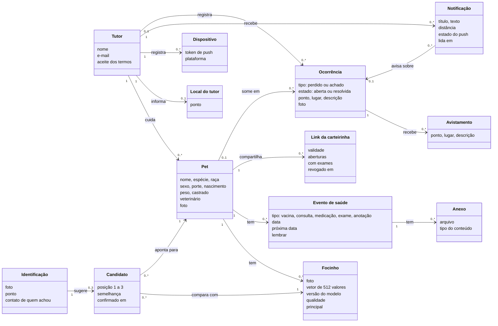

# Diagrama de domínio

Os conceitos do Nupii e as relações entre eles, escritos a partir do sistema pronto ([roteiro](roteiro.md), fatia 11). Os nomes seguem o app e os requisitos; entre parênteses, a tabela do [modelo de dados](modelo-de-dados.md).

## Regras que o diagrama não mostra

- Um pet tem no máximo um focinho principal (RN-09) e no máximo um desaparecimento aberto (RN-68). Os dois são índices únicos do [modelo de dados](modelo-de-dados.md).
- Uma identificação é anônima: ela não tem tutor. O contato de quem achou fica nela até a limpeza (RN-42).
- Um achado pode não ter tutor: quem registra sem conta resolve pelo código (RF-19, RF-21).
- Dois vetores só são comparados com a mesma versão do modelo (RF-15).
- Um tutor excluído continua no banco, anonimizado e marcado (`deleted_at`). Os dados dele são apagados ou anonimizados na exclusão (RF-08, [ADR 0028](adr/0028-exclusao-da-conta-e-limpeza.md)).
- A fila de jobs (`jobs`) é infraestrutura: ela leva os alertas, a exclusão no Firebase, a remoção de arquivos e a limpeza. Ela não é um conceito do domínio.
