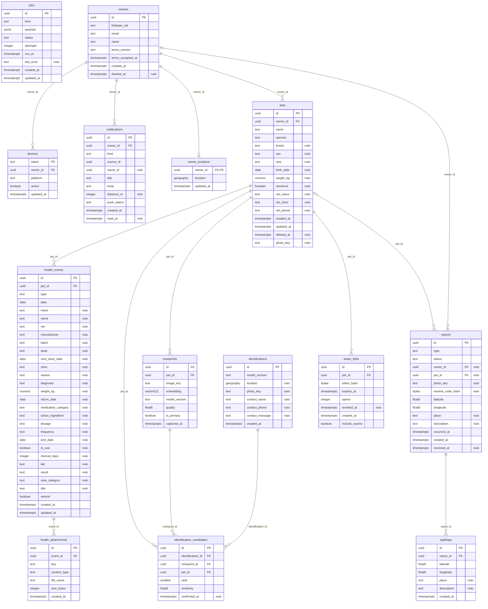

# Modelo de dados (DER)

As tabelas do PostgreSQL do Nupii, escritas a partir do sistema pronto ([roteiro](roteiro.md), fatia 11). O diagrama foi gerado do esquema de um banco com todas as migrations de `backend/db/migrations` aplicadas (versão 16, `00016_share_link_exams.sql`). Ele tem as 14 tabelas e as 14 chaves estrangeiras das migrations. Os conceitos estão no [diagrama de domínio](dominio.md).

Ficam fora do diagrama `goose_db_version` (o controle das migrations) e `spatial_ref_sys` (a tabela da extensão PostGIS). O schema `metrics` (migration 00017) só tem views de contagem para o Grafana, sem tabelas próprias ([ADR 0032](adr/0032-observabilidade-lgtm.md), item 9).

Legenda: `PK` chave primária, `FK` chave estrangeira, `"nulo"` coluna que aceita nulo. Os tipos: `geography` é `geography(Point,4326)` do PostGIS, `vector512` é `vector(512)` do pgvector, `numeric` é `numeric(5,2)`.

## Restrições únicas

| Tabela | Colunas | Regra |
|---|---|---|
| `owners` | `firebase_uid` | Um tutor por conta do Firebase. |
| `noseprints` | `pet_id` onde `is_primary` | Um focinho principal por pet (RN-09). |
| `reports` | `pet_id` onde `type = 'lost'` e `status = 'open'` | Um desaparecimento aberto por pet (RN-68). |
| `identification_candidates` | `identification_id`, `rank` | Uma posição por candidato. |
| `notifications` | `owner_id`, `kind`, `source_id` | Uma notificação por evento e por tutor. |
| `share_links` | `token_hash` | O token do link é único; a tabela guarda só o hash. |
| `jobs` | `kind`, `run_at` onde `kind = 'purge_expired_data'` | Uma limpeza diária por horário (RF-32). |

## Exclusões

As chaves estrangeiras não têm `ON DELETE CASCADE` (a ação é `NO ACTION`): as queries apagam as linhas filhas antes da linha mãe, por exemplo `health_attachments` antes de `health_events`. A exclusão da conta não apaga a linha do tutor: ela anonimiza o tutor, grava `deleted_at` e apaga ou anonimiza os dados de cada módulo na mesma transação ([ADR 0028](adr/0028-exclusao-da-conta-e-limpeza.md)). Os arquivos (fotos, anexos) ficam no S3, e as colunas `*_key` guardam o caminho deles.
